<p align="center">
  
</p>

<p align="center">
  <a href="https://www.linkedin.com/in/amilcar-steban-rodriguez-martinez-6a65532a4/"></a>
  <a href="mailto:amilcarshm@gmail.com"></a>
  <a href="https://instagram.com/stebanr.09"></a>
  
</p>


<table>
<tr>
<td width="50%" valign="top">

**Telematics Engineer** working as a **DevOps & Software Engineer**.

I automate the path from `git push` to production: containers, CI/CD, GitOps on Kubernetes and cloud infrastructure as code.

Fast delivery **without sacrificing reliability**: observability and security built into the pipeline.

</td>
<td width="50%" valign="top">

```yaml
kind: Engineer
metadata:
  name: amilcar-rodriguez
spec:
  focus: [CI/CD, GitOps, K8s, IaC]
  cloud: [AWS, Azure, GCP]
  code: [Python, Java, JS, Bash]
  motto: "Do it twice? Automate it."
```

</td>
</tr>
</table>




<p align="center">
  <a href="https://github.com/Amilcar-Steban/roadmap-devops-2027"></a>
  <a href="https://github.com/Amilcar-Steban/tienda-pipeline"></a>
  <a href="https://github.com/Amilcar-Steban/tienda-gitops"></a>
  <a href="https://github.com/Amilcar-Steban/tienda-agente"></a>
  <a href="https://github.com/Amilcar-Steban/MicroserviceApp-Kubernetes-Helm"></a>
  <a href="https://github.com/Amilcar-Steban/VM-Ansible-AZ"></a>
</p>




<p align="center">
  
</p>


<p align="center">
  Open to collaborating on <b>DevOps, platform engineering and cloud-native</b> projects.<br />
  <a href="mailto:amilcarshm@gmail.com">amilcarshm@gmail.com</a> · <a href="https://www.linkedin.com/in/amilcar-steban-rodriguez-martinez-6a65532a4/">LinkedIn</a>
</p>


